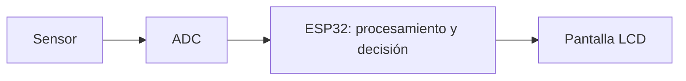
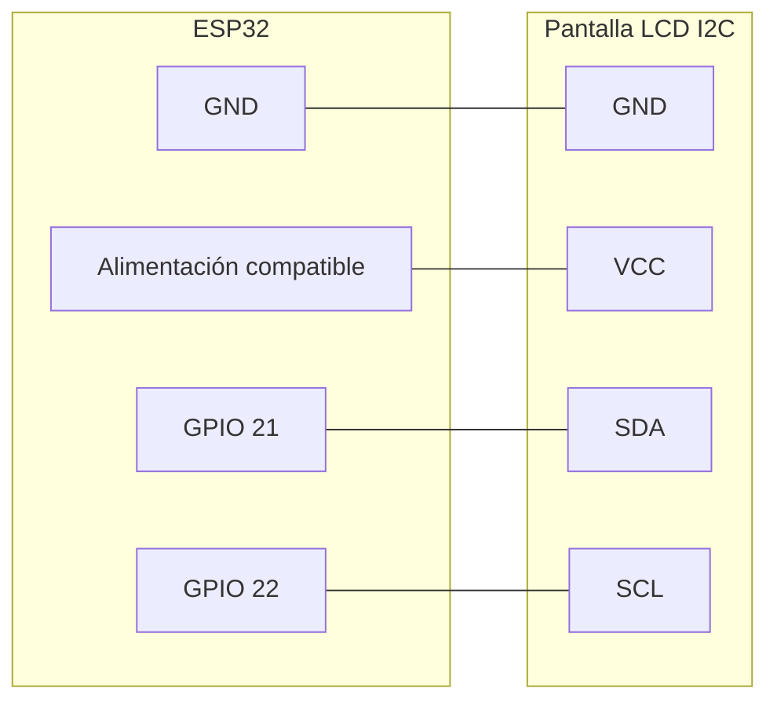

# Sistemas Digitales

**Fecha:** martes, 24 de noviembre de 2026  
**Tema:** Procesamiento digital de señales, ADC de la ESP32 y pantalla LCD.

---

## 1. Procesamiento digital de señales (PDS)

Permite transformar variables físicas continuas en secuencias de números que un microcontrolador puede interpretar y procesar.

| Señal analógica | Señal digital |
|---|---|
| Continua en amplitud y tiempo. | Representada mediante valores discretos. |
| Ejemplo: voltaje de un sensor. | Ejemplo: lectura del ADC. |

## 2. Cadena de digitalización

### 2.1. Sensor

Captura una variable física, como temperatura o luz, y la transforma en una señal eléctrica.

### 2.2. Muestreo

Consiste en tomar muestras de una señal cada intervalo de tiempo $T_s$.

- $T_s$: período de muestreo, en segundos.
- $F_s$: frecuencia de muestreo, en muestras por segundo (Hz).

$$F_s=\frac{1}{T_s}$$

$$x[n]=x(nT_s)$$

### 2.3. Cuantización

Consiste en aproximar cada muestra al nivel discreto más cercano. La cantidad de niveles depende del número de bits del convertidor.

$$L=2^N$$

Donde $N$ es el número de bits y $L$ la cantidad de niveles.

### 2.4. LSB (Least Significant Bit)

Es el bit menos significativo. Su peso representa el tamaño de un escalón de cuantización.

$$LSB=\frac{V_{FE}}{2^N}$$

Donde $V_{FE}$ es el intervalo de fondo de escala. Cuantos más bits, menor es el escalón de cuantización y mayor es la resolución ideal.

### 2.5. Codificación

Representa los niveles cuantificados mediante códigos binarios.

## 3. Conversor analógico-digital (ADC)

Convierte una señal analógica en valores digitales. La ESP32 clásica tiene una resolución habitual de 12 bits.

$$2^{12}=4096$$

Los códigos digitales van de **0 a 4095**.

### 3.1. ADC1 y ADC2 de la ESP32 clásica

| Característica | ADC1 | ADC2 |
|---|---|---|
| Canales | 8 | 10 |
| GPIO | 32 al 39 | 0, 2, 4, 12 al 15 y 25 al 27 |
| Resolución habitual | 12 bits | 12 bits |
| Uso con Wi-Fi | Compatible | Presenta restricciones |
| Pines de arranque (strapping) | No | Algunos |

Se recomienda ADC1 cuando se utiliza Wi-Fi. No todos los GPIO están necesariamente disponibles en cada placa.

### 3.2. Del sensor a la decisión

El sensor genera una señal eléctrica, el ADC la convierte en un número y la ESP32 aplica operaciones como escalado, filtrado y toma de decisiones. El resultado se puede mostrar en una pantalla LCD.

## 4. Teorema de Nyquist

Para una señal limitada en banda, la frecuencia de muestreo debe superar el doble de su frecuencia máxima.

$$F_s>2F_{max}$$

### 4.1. Aliasing

Ocurre cuando la frecuencia de muestreo es insuficiente y las muestras representan incorrectamente la frecuencia de la señal original.

## 5. Ruido en las señales

El ruido introduce variaciones no deseadas en las mediciones.

| Método | Reducción del ruido |
|---|---|
| Hardware | Condensador cerámico para reducir fluctuaciones. |
| Software | Tomar varias muestras y promediarlas. |

### 5.1. Filtro de promedio móvil

Calcula el promedio de las últimas $N$ muestras para suavizar la señal y reducir el ruido de alta frecuencia.

$$y[n]=\frac{1}{N}\sum_{k=0}^{N-1}x[n-k]$$

## 6. Pantalla LCD

LCD significa *Liquid Crystal Display* (pantalla de cristal líquido). Los cristales líquidos no emiten luz propia, sino que controlan el paso de la luz.

### 6.1. LCD 16 × 2

Tiene 16 columnas y 2 filas, lo que permite visualizar 32 caracteres simultáneamente.

### 6.2. Pines principales

| Pin | Nombre | Función |
|---|---|---|
| 1 | VSS | Tierra (GND). |
| 2 | VDD | Alimentación, habitualmente 5 V. |
| 3 | V0 | Ajuste del contraste mediante potenciómetro. |
| 4 | RS | Selección de comandos o datos. |
| 5 | RW | Lectura o escritura; GND para escritura. |
| 6 | E | Habilita la transferencia. |

### 6.3. Conexión mediante I2C

| ESP32 | LCD I2C | Función |
|---|---|---|
| GND | GND | Tierra común. |
| Alimentación compatible | VCC | Alimentación del módulo. |
| GPIO 21 | SDA | Línea de datos. |
| GPIO 22 | SCL | Línea de reloj. |

> **Precaución:** comprobar la alimentación y los niveles lógicos del módulo. La ESP32 utiliza GPIO de 3,3 V; un módulo I2C con resistencias de pull-up a 5 V puede requerir adaptación de niveles.

## 7. Glosario

| Término | Significado |
|---|---|
| PDS | Procesamiento digital de señales. |
| ADC | Conversor analógico-digital. |
| GPIO | Entrada y salida de propósito general. |
| LCD | Pantalla de cristal líquido. |
| LSB | Bit menos significativo. |
| I2C | Protocolo de comunicación serial. |
| SDA | Línea de datos. |
| SCL | Línea de reloj. |
| Strapping | Pines que intervienen en la configuración de arranque. |
| Aliasing | Representación incorrecta por muestreo insuficiente. |

## 8. Formulario

| Concepto | Fórmula |
|---|---|
| Frecuencia de muestreo | $F_s=1/T_s$ |
| Período de muestreo | $T_s=1/F_s$ |
| Señal muestreada | $x[n]=x(nT_s)$ |
| Niveles de cuantización | $2^N$ |
| Resolución ideal | $LSB=V_{FE}/2^N$ |
| Criterio de Nyquist | $F_s>2F_{max}$ |
| Promedio móvil | $y[n]=\frac{1}{N}\sum_{k=0}^{N-1}x[n-k]$ |

## 9. Resumen general

La ESP32 puede adquirir señales de sensores mediante el ADC, procesar sus valores digitales, reducir el ruido mediante filtros y mostrar resultados en una pantalla LCD. El muestreo y la cuantización son etapas fundamentales de la digitalización.

