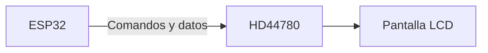
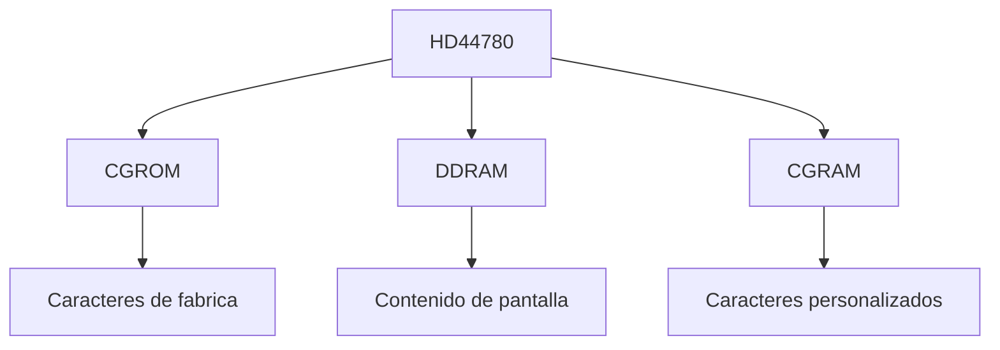
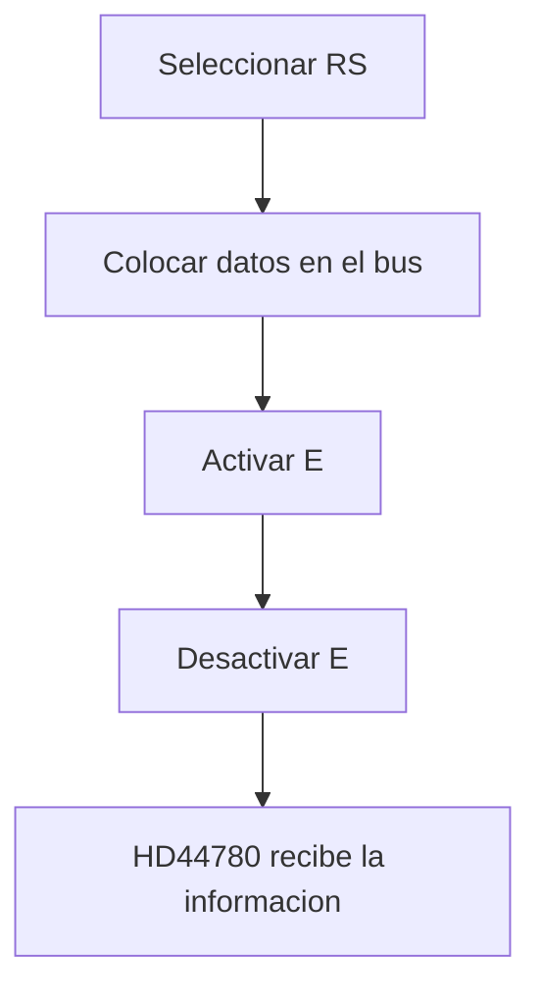
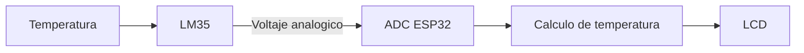

# Sistemas Digitales

**Unidad:** 02  
**Clase:** 02  
**Fecha:** miércoles, 25 de noviembre de 2026  
**Tema:** Controlador LCD HD44780, sensor de temperatura LM35 y decibelios.

---

## 1. Controlador HD44780

El HD44780 es el controlador de la pantalla LCD. Funciona como su cerebro: recibe instrucciones y datos, administra la memoria y controla la representación de los caracteres en pantalla.

## 2. Memorias del HD44780

El controlador dispone de tres memorias principales: CGROM, DDRAM y CGRAM.

| Memoria | Función | Ejemplo |
|---|---|---|
| CGROM | Almacena los patrones de caracteres definidos de fábrica. | Letras y números. |
| DDRAM | Almacena los códigos de los caracteres que se desean mostrar. | Texto visible en pantalla. |
| CGRAM | Permite definir caracteres personalizados. | Flechas, símbolos o iconos propios. |

### 2.1. CGROM (Character Generator ROM)

Contiene los patrones de los caracteres definidos de fábrica. Es como un libro de caligrafía que indica cómo dibujar cada letra.

### 2.2. DDRAM (Display Data RAM)

Almacena los códigos de los caracteres que el controlador muestra en la pantalla. También puede contener posiciones que no son visibles simultáneamente.

### 2.3. CGRAM (Character Generator RAM)

Permite crear hasta **8 caracteres personalizados**, identificados del 0 al 7, en el modo habitual de caracteres de 5 × 8 puntos.

## 3. Pines de control del LCD

### 3.1. RS (Register Select)

Selecciona si la información enviada corresponde a un comando o a un dato.

| RS | Tipo | Ejemplo |
|---|---|---|
| 0 | Comando | Borrar la pantalla o mover el cursor. |
| 1 | Dato | Escribir una letra o un número. |

### 3.2. R/W (Read/Write)

Determina si se realiza una operación de lectura o escritura.

- R/W = 0: escritura.
- R/W = 1: lectura.

Al conectar R/W a GND, el microcontrolador siempre escribe en el LCD. Esto permite ahorrar un pin de la ESP32, aunque impide leer el estado del controlador.

### 3.3. E (Enable)

Habilita la transferencia. Se puede comparar con un botón de envío: durante una escritura, el HD44780 captura la información en el flanco de bajada de E.

## 4. Sensor de temperatura LM35

El LM35 es un sensor analógico cuya tensión de salida es proporcional a la temperatura en grados Celsius.

Su sensibilidad es de **10 mV por cada grado Celsius**.

### 4.1. Relación entre voltaje y temperatura

$$V_{mV}=10T$$

Para obtener la temperatura a partir del voltaje medido en milivoltios:

$$T=\frac{V_{mV}}{10}$$

Donde:

- $T$: temperatura en grados Celsius (°C).
- $V_{mV}$: tensión de salida en milivoltios (mV).

| Temperatura | Tensión de salida ideal |
|---|---|
| 1 °C | 10 mV |
| 2 °C | 20 mV |
| 25 °C | 250 mV |
| 50 °C | 500 mV |
| 110 °C | 1100 mV |
| 150 °C | 1500 mV |

Los valores de 1, 2 y 150 °C aparecen en los apuntes; los demás ilustran la misma relación matemática. El máximo de 150 °C corresponde a ciertas variantes del LM35, no necesariamente a todas.

### 4.2. Lectura mediante el ADC de la ESP32

En los apuntes se indica un límite de 1,1 V (1100 mV). Si ese fuera el fondo de escala de la configuración utilizada, el límite ideal de lectura sería:

$$T=\frac{1100}{10}=110\ ^\circ\mathrm{C}$$

**Aclaración:** 1,1 V es una referencia nominal del ADC de la ESP32 clásica, no un límite universal de entrada. El rango medible depende de la atenuación, la variante del chip y la calibración. Los apuntes no especifican esa configuración.

## 5. Decibelios (dB)

El decibelio es una unidad logarítmica que expresa la relación entre dos magnitudes. En el caso de la potencia, permite comparar una potencia de salida con una potencia de entrada y expresar ganancias o pérdidas.

### 5.1. Relación de potencias

Como complemento a los apuntes, se utiliza la siguiente expresión:

$$G_{dB}=10\log_{10}\left(\frac{P_{salida}}{P_{entrada}}\right)$$

| Resultado | Interpretación |
|---|---|
| Positivo | Ganancia de potencia. |
| Cero | Misma potencia de entrada y salida. |
| Negativo | Pérdida de potencia. |

### 5.2. Pérdidas en cada etapa

Los apuntes mencionan calcular las pérdidas de cada escalón. Si existen varias etapas consecutivas, sus ganancias o pérdidas expresadas en dB se pueden sumar algebraicamente.

$$G_{total}=G_1+G_2+\cdots+G_n$$

Ejemplo complementario: si una etapa pierde 3 dB y otra pierde 2 dB, la ganancia total es −5 dB, es decir, una pérdida de 5 dB.

## 6. Glosario

| Término | Significado |
|---|---|
| HD44780 | Controlador de pantallas LCD de caracteres. |
| CGROM | Memoria de patrones de caracteres de fábrica. |
| DDRAM | Memoria de datos de visualización. |
| CGRAM | Memoria de caracteres personalizados. |
| RS | Selección de registro. |
| R/W | Selección de lectura o escritura. |
| E | Señal de habilitación. |
| LM35 | Sensor analógico de temperatura. |
| ADC | Convertidor analógico-digital. |
| mV | Milivoltio. |
| dB | Decibelio. |
| Flanco de bajada | Transición de nivel alto a nivel bajo. |

## 7. Formulario de la clase

| Concepto | Fórmula |
|---|---|
| Salida del LM35 en mV | $V_{mV}=10T$ |
| Temperatura en °C | $T=V_{mV}/10$ |
| Ganancia de potencia | $G_{dB}=10\log_{10}(P_{salida}/P_{entrada})$ |
| Ganancia total en dB | $G_{total}=\sum_{i=1}^{n}G_i$ |

## 8. Resumen general

El HD44780 controla los caracteres de la pantalla LCD mediante tres memorias y señales de control como RS, R/W y E. El sensor LM35 convierte la temperatura en una tensión proporcional de 10 mV/°C, que puede ser digitalizada mediante el ADC de la ESP32. Los decibelios permiten representar de manera logarítmica relaciones de potencia y calcular ganancias o pérdidas en distintas etapas.

---

**Fuente:** apuntes manuscritos de la clase del 25 de noviembre de 2026.

**Complementos:** se añadieron diagramas Mermaid, ejemplos de temperatura, precisiones sobre las memorias y señales del LCD, la aclaración sobre el rango del ADC y las fórmulas y el ejemplo de decibelios. Estos complementos explicativos no son una transcripción literal de los apuntes.
